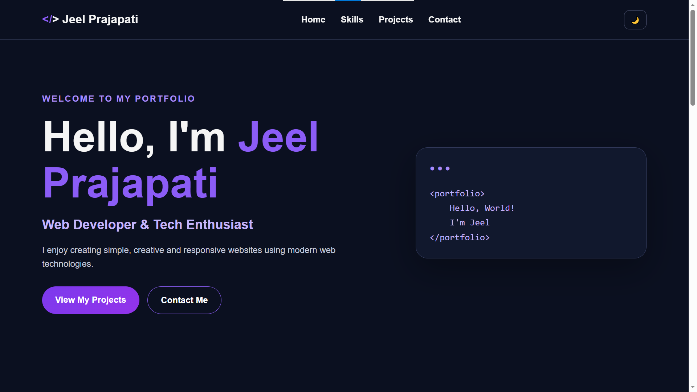

# Jeel Prajapati - Portfolio

This is my personal portfolio website created as part of my Web Technology project.

## Technologies Used

- HTML5
- CSS3
- JavaScript
- GitHub

## Features

- Home/About Me section
- Skills section
- Projects section
- Contact form with validation
- Responsive layout for laptop and mobile screens
- Mobile navigation menu
- Dark/light mode

## Projects

1. Calculator App - A simple calculator made using HTML, CSS and JavaScript.
2. Treasure Hunt Game - A Python-based mini game.

## Screenshot

Add a screenshot of the portfolio homepage here:

## Student Details

**Name:** Jeel Prajapati  
**Roll No.:** 267725

## GitHub

Repository: https://github.com/jeelprajapati01/Jeel_267725_Portfolio
